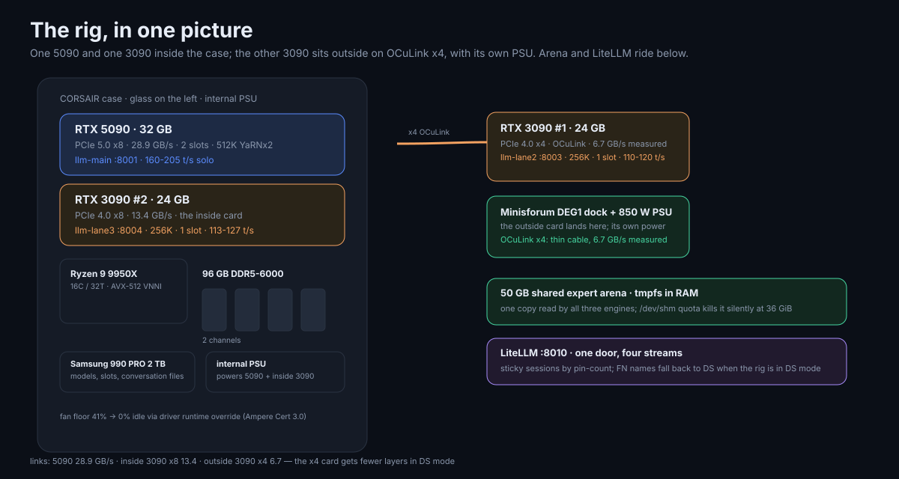
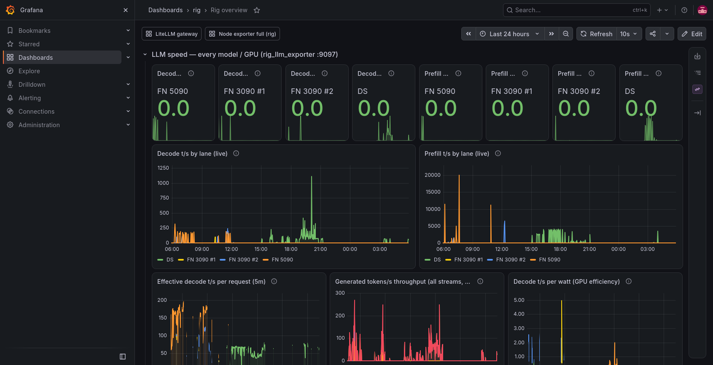

# home-llm

**Three GPUs. 96 GB of DDR5. 512K of context. No cloud.**

This is the build log of a home LLM rig in Belgrade: one RTX 5090, two RTX 3090s, a
Ryzen 9 9950X, and a pile of experiments that did not survive contact with real agent
traffic. It began as a Mac and a Steam Deck; it ended as a box where Qwen and DeepSeek
both run locally. Every number below was measured here and can be re-run from this repo.

*The box in the room: the 5090 and one 3090 live inside the case; the other 3090 sits
outside on a thin OCuLink x4 cable, through the Minisforum DEG1 dock and its own 850 W PSU
(the black boxes on top).*

> **How to read the numbers.** `NOW` = the production config serving today.
> `LAST` = a build that is installed but not currently serving; the date next to each number
> is the date of that measurement. `RETIRED` = an earlier phase or config, kept for the story,
> **not current**. Every number carries one of these tags; they are not mixed into one table.

## Two builds, two states

**FN — `LAST` (active until 12.11; last full bench 30.10), not current.** Qwen3.8-Flash-Next IQ3_S ([SC117 abliterated GGUF](https://huggingface.co/SC117/Qwen3.8-Flash-Next-GSQ-RCO-abliterated-GGUF))
on [Strata](https://github.com/Niko1221/Strata). Three lanes: the 5090 at 512K with two slots,
the two 3090s at 256K with one slot each, one shared **50 GB expert arena** in RAM.
[LiteLLM](https://github.com/BerriAI/litellm) sits in front; four streams total. The build
is installed, but the lanes are **stopped while DS mode is on** — FN served the box until
DS came up on 12.11 evening; the numbers below are from the last full FN bench (30.10),
not today's rig.

**DS — `NOW` (13.11, final prod).** DeepSeek-V4.1-Flash Maya-XS on
[Project Maya](https://github.com/mw00/project-maya). All three GPUs work on one model:
512K context, DSpark, `--parallel 2`, final split `16,8,16`, four prefill flags.
This is what serves the box today; the live numbers are below.

## Right now: DS production (13.11)

`NOW` — rig mode **DS** (switched 12.11 evening). Config on the box: Maya v1.1.61 + PR [#959](https://github.com/mw00/project-maya/pull/959),
`DS4_SPLIT=16,8,16`, `DS4_FLOW_COPY_DMA`, `DS4_AI_RUN`, `DS4_YOCO_FLOW`, `MAYA_DS4_PREFILL_CPU`,
`--max-context 524288 --dspark on --parallel 2`. Experts: 9.2k in VRAM, 6.6k (47 GB) in RAM,
Engram Q6_K on NVMe.

**Live snapshot 13.11 12:46 CET (11:46Z).** Instant: **decode 90.9 t/s**, **prefill 398 t/s**,
prefix reuse **98.6%**. Over the last 30 minutes: **decode 63.4 t/s avg**, **prefill 2,367 t/s avg**,
prefix reuse **97.6%**, 106 requests, average prompt 326K tokens. Final-config A/B decode:
**66.8 t/s**; `--parallel 2` aggregate: **81.5 t/s**. These move every second — the snapshot is dated.

**Cold prefill, final production config** (`r-s1688`: split 16,8,16 + the four flags; medians of two rounds):

| Prompt | Tokens read | Cold prefill | Read time |
|---|---|---|---|
| 24K | 28,560 | **2,929 t/s** | 9.7 s |
| 128K | 148,868 | **3,721 t/s** | 40.0 s |
| 462K | 462,576 | **3,248 t/s** | 142 s |
| 483K | extrapolated | — | **≈149 s** |

The A/B's "400K" arm is actually a **462.5K-token** prompt; I use the real token count above.
483K is not a separate cold run — it is extrapolated from the 462K point (483,000 / 3,248 ≈ 149 s).
**The old "483K = 1,074 t/s / 7.5 min" number is `RETIRED`** (pre-flag 18,9,13 config); it is not current.

Agent turns after a warm start: `+0.6K` **1.3 s**, `+1.2K` **2.0 s**, `+3K` **3.6 s**. FN lanes
are down in DS mode — there are no current FN numbers to mix into this table.

## FN: active until 12.11, last full bench 30.10

`LAST` — FN is installed (Strata 0.1.58.2, shared arena, parking), but it served the box only
until **12.11 evening**, when DS came up. The table below is the **last full FN bench (30.10)**,
not the last day of FN production.

| Lane | Decode | Prefill | Context |
|---|---|---|---|
| FN 5090 · 2 streams | **184 t/s** (160–205 solo) | **6.4–7.3k t/s** | 512K, 2 slots |
| FN 3090 #1 | **110–120 t/s** solo; 98–111 with all three | **~2.8k t/s** @30K+ | 256K, 1 slot |
| FN 3090 #2 · x4 | **113–127 t/s** solo; 90–125 with all three | **~2.8k t/s** | 256K, 1 slot |
| Four streams together | **371–392 t/s** aggregate | — | 4 sessions |

These are **30.10 bench numbers**, not a claim about the current rig. Switching back to FN is
`rig_mode.sh fn` on the rig; the mode is owner-side, not a background toggle.

## Retired numbers — do not read these as current

`RETIRED` — old phases and old configs. Kept here so the story is complete; none of it
describes the production box today.

| What | When | Old number | Why it is not current |
|---|---|---|---|
| DS 483K prefill, pre-flag 18,9,13 | 12.11 20:00 | **1,074 t/s / 7.5 min** | Replaced by prefill flags + final split 16,8,16; current 462K point is 3,248 t/s / 142 s |
| DS base prefill (no flags) | 12.11 22:10 | 1,429 t/s @24K; 1,552 t/s @128K | Prefill flags lifted cold read **1.9–2.1×**; base is retired |
| DS split 18,9,13 (`r-prod`) | 12.11 22:48 | 2,719 / 3,302 / 2,875 t/s @24/128/400K | Split changed to **16,8,16**: 2,929 / 3,721 / 3,248 t/s |
| DS on 2 cards vs 3 cards | 12.11 21:00 | 1,640–1,680 vs 1,450–1,490 t/s @24K; decode 48 vs 65 | Three cards kept; the comparison is retired |
| Mac 5 engines (Splash/TensorFold/oMLX/llama.cpp) | 10.10 | 33.4 / 26.7 / 24.3 / 12.7 t/s | Mac phase ended; 20K agent chat on M3 Max |
| Deck + DEG1 + 5090 prefill | 25.10 | **11.3k t/s** prefill, 240K context | Deck phase ended; the rig is the current box |
| vLLM 27B TP/PP | 26–30.10 | TP2 **6.5 t/s**, PP2 **44.6 t/s**, one engine/card **95–100 t/s** | 27B weights, venv and source removed on 13.11; rollback = re-download |
| DFlash2 on 3090s | 10.11 | RU **119 → 107 t/s** | Rejected; never beat MTP + Cyrillic draft vocab |
| OpenJet trial | 28.10 | Synthetic win, real agent **531 s vs 116 s** | Rolled back the same day |
| Layer-major prefill on lane3 | 10.11 | ~10 t/s with RAM experts | Not our case; drive-fed experts only |

## The rig, in one picture

Ryzen 9 9950X (16C/32T, AVX-512 VNNI) · 96 GB DDR5-6000 (2 channels) · RTX 5090 32 GB
(PCIe 5.0 x8) · RTX 3090 24 GB (PCIe 4.0 x4, OCuLink) · RTX 3090 24 GB (PCIe 4.0 x8) ·
Samsung 990 PRO 2 TB · Ubuntu 26.10 · NVIDIA driver 615.71 · CUDA 13.1.

One 3090 runs inside the case on a PCIe x8 riser; the other runs outside on the DEG1 dock,
over OCuLink x4, powered by its own 850 W PSU. Measured links: **5090 28.9 GB/s, inside
3090 x8 13.4 GB/s, outside 3090 x4 6.7 GB/s**. The x4 card is why the DS layer split gives
fewer layers to the slow link, and why the CPU expert pool has to be planned rig-wide.

## The room when it works

| Rig monitor | Grafana |
|---|---|
|  |  |

The monitor screenshot is a dated capture (**13.11 05:52 CET, DS idle**); the current numbers
are the **12:46 snapshot** above. The monitor at `:8090` shows lanes, mode, live t/s, GPU load,
VRAM, temps and request history. [Grafana](https://grafana.com) keeps the long view and
[Prometheus](https://prometheus.io) throws the alerts into Telegram. A watchdog lives on
another box, outside the rig.

*Real requests, DS mode: long prompts reuse 346K tokens of cache, decode sits around 60–88 t/s.*

*Every sensor Linux exposes: CPU clock, per-GPU fans and power, VRAM, thermals, pump RPM.*

## Timeline — dated history, not current production

Everything in this section is history. The current build and its numbers are in the section
above; do not read these as the rig today.

- **Oct 10–11 · Mac M3 Max 48 GB.** Five engines, same 20K-token agent chat:
  [Splash](https://github.com/incoai/splash) + DFlash2 won at 33.4 t/s, TensorFold 26.7,
  oMLX 23–26, [llama.cpp](https://github.com/ggml-org/llama.cpp) MTP 12.7. Lesson: prefill,
  not decode, decides agent latency.
- **Oct 25–26 · Steam Deck + DEG1 + RTX 5090.** [NInfer](https://github.com/Neroued/ninfer)
  served Qwen3.8-27B NVFP4 at 11.3k t/s prefill, 240K context, vision. KV fp8 -> k8v4 added
  28% KV pool; the OCuLink x4 link barely cost decode. This phase is in [`deck/`](deck/).
- **Oct 26–30 · the rig.** vLLM 27B without NVLink: TP=2 was **6.5 t/s** (all-reduce through
  host SHM), PP=2 **44.6 t/s**, one engine per card **95–100 t/s**. TP on GeForce without P2P
  is a trap; the fix is fewer GPUs doing more work, not bigger tensors.
- **Oct 30–Nov 2 · Flash-Next on all three cards.** One 50 GB arena, three engines,
  conversation parking (PRs [#3565](https://github.com/Niko1221/Strata/pull/3565) and
  [#3341](https://github.com/Niko1221/Strata/pull/3341) rebased and running here).
- **Nov 2–6 · parking + Russian sampling.** 442K tokens restored in **4.8 s** (74 s cold);
  RU glitches **18.3% -> 1.7%** with T 0.7 + min_p 0.05, not a new model.
- **Nov 6 · the save bug.** Strata's DFlash2-auto silently broke session saves; the guard
  written here became upstream [PR #1492](https://github.com/Niko1221/Strata/pull/1492).
- **Nov 10–12 · what streaming cards hate.** Two rounds of [DFlash2](https://huggingface.co/incoai/Qwen3.8-Flash-Next-DFlash2)
  on 3090s: RU 119 -> 107 t/s, never better than MTP + Cyrillic draft vocab. Layer-major
  prefill pays only for drive-fed experts; with RAM-resident experts it refuses to engage
  or collapses to ~10 t/s.
- **Nov 12 · DeepSeek on the whole box.** Maya-XS v2, PR [#959](https://github.com/mw00/project-maya/pull/959)
  prefill-on-CPU, DSpark, and a layer split tuned to link speed.
- **Nov 13 · final DS prod tuning.** Split **16,8,16** from 00:15, four prefill flags, cold
  462K read **142 s**; old 7.5-min number retired.

## What the benchmarks got wrong

- **[OpenJet](https://github.com/L-Forster/open-jet) "2.6× faster"** on synthetic benches turned into **531 s vs 116 s** on the same
  real agent task. Rolled back the same day. Synthetic throughput is not agent traffic.
- **TP=2 without NVLink** looks fine in a table and dies in a long agent turn.
- **DFlash2 on cards that stream experts from RAM** is slower than MTP for Russian, even when
  its acceptance rate looks better.
- **Layer-major prefill** is the right answer for drive-fed experts and the wrong one when
  the experts already sit in a RAM arena.

## Repo map

| Path | What |
|---|---|
| [`deck/`](deck/) | Deck + DEG1 + 5090 as a server: services, monitor, Ratatui TUI |
| [`bench/results/`](bench/results/) | Deck benchmarks: TensorFold vs NInfer, KV dtype and draft sweep |
| [`mac-local/`](mac-local/) | Mac phase harnesses and raw results |
| [`rig/`](rig/) | systemd units, Strata presets (keys redacted), monitor/Grafana, LiteLLM hook, patches, bench scripts |
| [`docs/journal.md`](docs/journal.md) | dated build log, every milestone with the receipts |
| [`install/`](install/) | autoinstall templates without secrets (`@SSH_KEYS@` placeholders) |

## Built on other people's work

None of this is a product. It is a pile of upstream work held together with configs:
[Strata](https://github.com/Niko1221/Strata), [Qwen3.8-Flash-Next](https://huggingface.co/SC117/Qwen3.8-Flash-Next-GSQ-RCO-abliterated-GGUF)
(SC117 abliterated GSQ-RCO), [Project Maya](https://github.com/mw00/project-maya) and
DeepSeek-V4.1-Flash, [HyperQwen](https://github.com/syv-ai/HyperQwen),
[vLLM](https://github.com/vllm-project/vllm), [NInfer](https://github.com/Neroued/ninfer),
[TensorFold](https://github.com/ashxhart/TensorFold), [Splash](https://github.com/incoai/splash),
[LiteLLM](https://github.com/BerriAI/litellm), [Grafana](https://grafana.com),
[Prometheus](https://prometheus.io), [OpenRGB](https://openrgb.org) and
[llama.cpp](https://github.com/ggml-org/llama.cpp).

Some of it went back upstream: HyperQwen [PR #423](https://github.com/syv-ai/HyperQwen/pull/423)
(Cyrillic draft vocab, merged), Strata [PR #1492](https://github.com/Niko1221/Strata/pull/1492)
(session save guard) and reports in Strata [#3341](https://github.com/Niko1221/Strata/pull/3341),
[#5106](https://github.com/Niko1221/Strata/issues/5106), [#5203](https://github.com/Niko1221/Strata/pull/5203),
plus Maya [#959](https://github.com/mw00/project-maya/pull/959).

## Reproduce

The dated story is in [`docs/journal.md`](docs/journal.md); the harness and raw JSON are in
[`bench/`](bench/) and [`rig/scripts/`](rig/scripts/). No license file is added to this repo —
upstream patches and vendored assets keep their own licenses.
