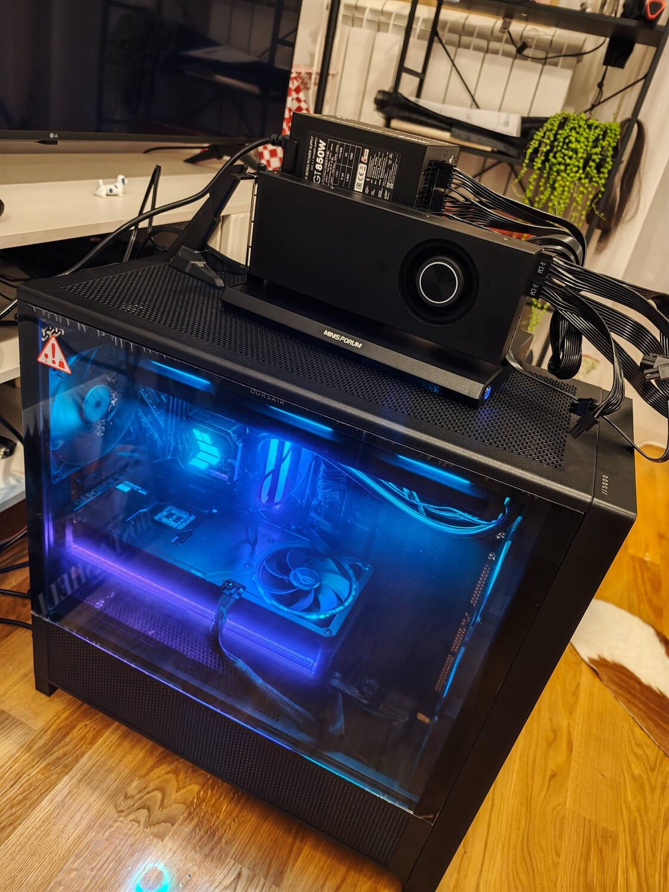
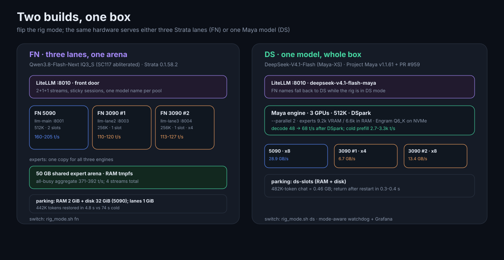
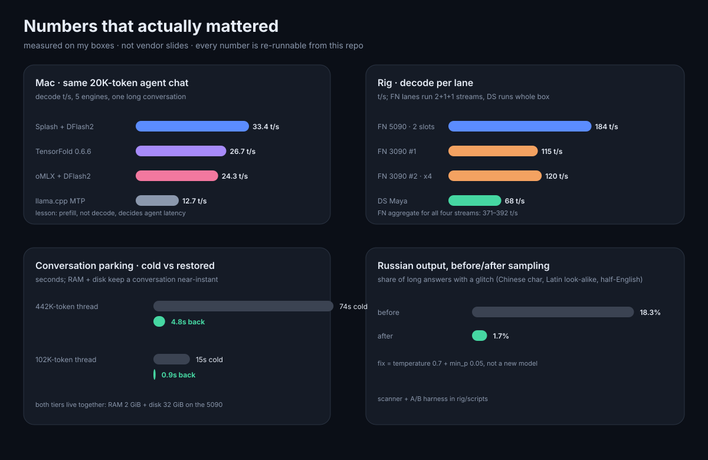
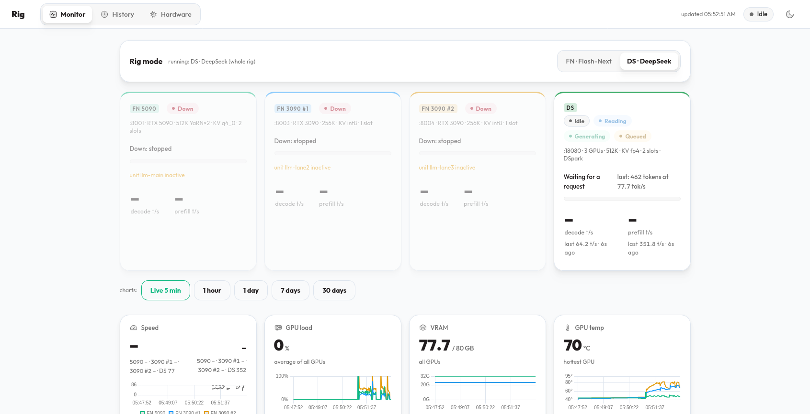
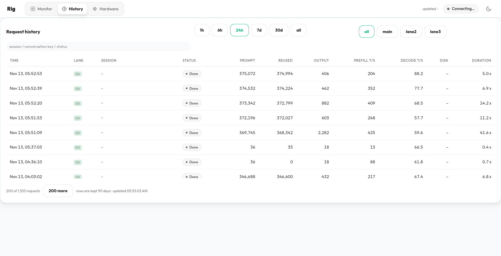
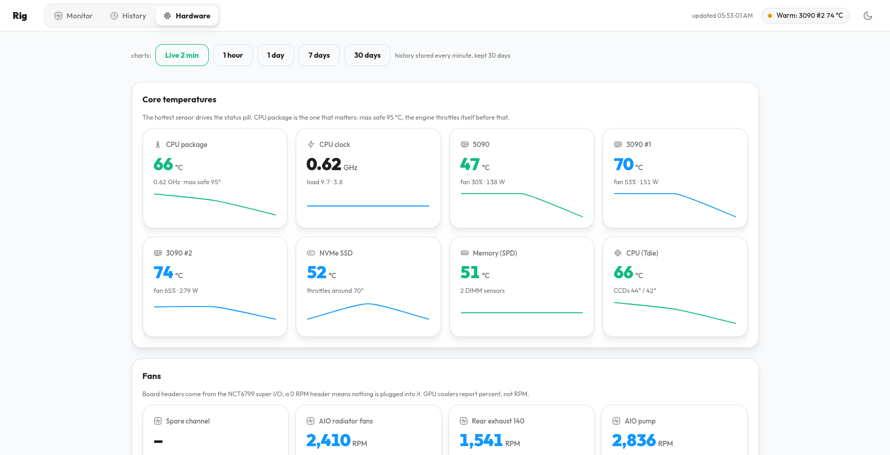

# home-llm

**Three GPUs. 96 GB of DDR5. 512K of context. No cloud.**

This is the build log of a home LLM rig in Belgrade: one RTX 5090, two RTX 3090s, a
Ryzen 9 9950X, and a pile of experiments that did not survive contact with real agent
traffic. It began as a Mac and a Steam Deck; it ended as a box where Qwen and DeepSeek
both run locally. Every number below was measured here and can be re-run from this repo.

*The box in the room. The 5090 lives inside the case; the two 3090s hang off it — one on a
PCIe x8 riser, one on a thin OCuLink x4 cable. The Minisforum DEG1 dock and its own PSU
are the leftover of the Steam Deck phase, now just part of the furniture.*

## Two builds, one switch

**[FN](https://github.com/Niko1221/Strata) — three lanes, one copy of the experts.**
Qwen3.8-Flash-Next IQ3_S ([SC117 abliterated GGUF](https://huggingface.co/SC117/Qwen3.8-Flash-Next-GSQ-RCO-abliterated-GGUF)) on [Strata](https://github.com/Niko1221/Strata):
the 5090 runs two slots at 512K, the two 3090s one slot each at 256K. All three engines read
one **50 GB expert arena** from RAM; [LiteLLM](https://github.com/BerriAI/litellm) in front
keeps conversations sticky per lane. 4 streams total, **371–392 t/s aggregate** when everything
is busy. The 5090 alone does 160–205 t/s solo; the 3090 lanes do 110–127 t/s.

**[DS](https://github.com/mw00/project-maya) — one model, the whole box.**
DeepSeek-V4.1-Flash Maya-XS on [Project Maya](https://github.com/mw00/project-maya): all three
GPUs work on one model, 512K context, DSpark speculative decoding, `--parallel 2`.
Decode went **48 -> 68 t/s** after DSpark calibration; cold prefill is 2.7–3.3k t/s, and
483K tokens read in about 7.5 minutes. Conversations park in RAM/disk (`ds-slots`) and come
back in 0.3–0.4 s. The FN model names fall back to DS while the rig is in DS mode.

Switching is one command on the rig: `rig_mode.sh fn|ds`. Currently the box is in **DS**
mode — the monitor screenshot below shows FN lanes down and Maya serving.

## The rig, in one picture

Ryzen 9 9950X (16C/32T, AVX-512 VNNI) · 96 GB DDR5-6000 (2 channels) · RTX 5090 32 GB
(PCIe 5.0 x8) · RTX 3090 24 GB (PCIe 4.0 x4, OCuLink) · RTX 3090 24 GB (PCIe 4.0 x8) ·
Samsung 990 PRO 2 TB · Ubuntu 26.10 · NVIDIA driver 615.71 · CUDA 13.1.

The measured link speeds matter: **5090 28.9 GB/s, 3090 x8 13.4 GB/s, 3090 x4 6.7 GB/s**.
That x4 card is the reason the DS layer split gives fewer layers to the slow link, and the
reason the CPU expert pool has to be planned rig-wide rather than per-engine.

## Numbers that actually mattered

- **371–392 t/s aggregate** on four streams — a whole rig answering at once, not one card
  pretending to be a server.
- **442K-token thread back in 4.8 s** (74 s cold) thanks to RAM+disk conversation parking.
  A 102K thread: 15 s cold, **0.9 s** back. The boring part that changes everything.
- **Russian glitches 18.3% -> 1.7%** with sampling (T 0.7 + min_p 0.05), not a new model.
  The scanner and A/B harness are in [`rig/scripts`](rig/scripts/).
- **DS decode 48 -> 68 t/s** after DSpark; cold prefill **1.9–2.1×** with three opt-in flow
  flags. The full 483K-token read: 7.5 min, needle intact.

## The room when it works

| The rig monitor | Grafana |
|---|---|
|  |  |

The monitor at `:8090` is the thing I actually look at: lanes, mode, live t/s, GPU load,
VRAM, temps, request history with prompt/reused/output tokens. It is fed by a vLLM-compatible
Prometheus exporter; [Grafana](https://grafana.com) keeps the 90-day history and
[Prometheus](https://prometheus.io) throws the alerts into Telegram. A watchdog lives on
another box, outside the rig, so the rig cannot grade its own homework.

*Real requests, DS mode: long prompts reuse 346K tokens of cache, decode sits around 60–88 t/s.*

*Every sensor Linux exposes: CPU clock, per-GPU fans and power, VRAM, thermals, pump RPM. The page that made fan control sane.*

## How it got here

- **Oct 10–11 · Mac M3 Max 48 GB.** Five engines, same 20K-token agent chat:
  [Splash](https://github.com/incoai/splash) + DFlash2 won at 33.4 t/s, TensorFold 26.7,
  oMLX 23–26, [llama.cpp](https://github.com/ggml-org/llama.cpp) MTP 12.7. Lesson: prefill,
  not decode, decides agent latency.
- **Oct 25–26 · Steam Deck + DEG1 + RTX 5090.** [NInfer](https://github.com/Neroued/ninfer)
  served Qwen3.8-27B NVFP4 at 11.3k t/s prefill, 240K context, vision. KV fp8 -> k8v4 added
  28% KV pool; the OCuLink x4 link barely cost decode. This is the phase already public in
  [`deck/`](deck/).
- **Oct 26–30 · the rig.** vLLM 27B without NVLink: TP=2 was **6.5 t/s** (all-reduce through
  host SHM), PP=2 **44.6 t/s**, one engine per card **95–100 t/s**. TP on GeForce without P2P
  is a trap; the fix is fewer GPUs doing more work, not bigger tensors.
- **Oct 30–Nov 2 · Flash-Next on all three cards.** One 50 GB arena, three engines,
  conversation parking (PRs [#3565](https://github.com/Niko1221/Strata/pull/3565) and
  [#3341](https://github.com/Niko1221/Strata/pull/3341) rebased and running here).
- **Nov 6 · the save bug.** Strata's DFlash2-auto silently broke session saves; the guard
  written here became upstream [PR #1492](https://github.com/Niko1221/Strata/pull/1492).
- **Nov 10–12 · what streaming cards hate.** Two rounds of [DFlash2](https://huggingface.co/incoai/Qwen3.8-Flash-Next-DFlash2) on 3090s: RU 119 -> 107 t/s,
  never better than MTP + Cyrillic draft vocab. Layer-major prefill pays only for drive-fed
  experts; with RAM-resident experts it refuses to engage or collapses to ~10 t/s.
- **Nov 12 · DeepSeek on the whole box.** Maya-XS v2, PR [#959](https://github.com/mw00/project-maya/pull/959)
  prefill-on-CPU, DSpark, and a layer split tuned to link speed.

## What the benchmarks got wrong

- **[OpenJet](https://github.com/L-Forster/open-jet) "2.6× faster"** on synthetic benches turned into **531 s vs 116 s** on the same
  real agent task. Rolled back the same day. Synthetic throughput is not agent traffic.
- **TP=2 without NVLink** looks fine in a table and dies in a long agent turn.
- **[DFlash2](https://huggingface.co/incoai/Qwen3.8-Flash-Next-DFlash2) on cards that stream experts from RAM** is slower than MTP for Russian, even when
  its acceptance rate looks better.
- **Layer-major prefill** is the right answer for drive-fed experts and the wrong one when
  the experts already sit in a RAM arena.

## Repo map

| Path | What |
|---|---|
| [`deck/`](deck/) | Deck + DEG1 + 5090 as a server: services, monitor, Ratatui TUI |
| [`bench/results/`](bench/results/) | Deck benchmarks: TensorFold vs NInfer, KV dtype and draft sweep |
| [`mac-local/`](mac-local/) | Mac phase harnesses and raw results |
| [`rig/`](rig/) | systemd units, Strata presets (keys redacted), monitor/Grafana, LiteLLM hook, patches, bench scripts |
| [`docs/journal.md`](docs/journal.md) | dated build log, every milestone with the receipts |
| [`install/`](install/) | autoinstall templates without secrets (`@SSH_KEYS@` placeholders) |

## Built on other people's work

None of this is a product. It is a pile of upstream work held together with configs:
[Strata](https://github.com/Niko1221/Strata), [Qwen3.8-Flash-Next](https://huggingface.co/SC117/Qwen3.8-Flash-Next-GSQ-RCO-abliterated-GGUF) (SC117 abliterated GSQ-RCO),
[Project Maya](https://github.com/mw00/project-maya) and DeepSeek-V4.1-Flash, [HyperQwen](https://github.com/syv-ai/HyperQwen),
[vLLM](https://github.com/vllm-project/vllm), [NInfer](https://github.com/Neroued/ninfer),
[TensorFold](https://github.com/ashxhart/TensorFold), [Splash](https://github.com/incoai/splash),
[LiteLLM](https://github.com/BerriAI/litellm), [Grafana](https://grafana.com),
[Prometheus](https://prometheus.io), [OpenRGB](https://openrgb.org) and
[llama.cpp](https://github.com/ggml-org/llama.cpp).

Some of it went back upstream: HyperQwen [PR #423](https://github.com/syv-ai/HyperQwen/pull/423)
(Cyrillic draft vocab, merged), Strata [PR #1492](https://github.com/Niko1221/Strata/pull/1492)
(session save guard) and reports in Strata [#3341](https://github.com/Niko1221/Strata/pull/3341),
[#5106](https://github.com/Niko1221/Strata/issues/5106), [#5203](https://github.com/Niko1221/Strata/pull/5203),
plus Maya [#959](https://github.com/mw00/project-maya/pull/959).

## Reproduce

The dated story is in [`docs/journal.md`](docs/journal.md); the harness and the raw JSON are in
[`bench/`](bench/) and [`rig/scripts/`](rig/scripts/). No license file is added to this repo —
upstream patches and vendored assets keep their own licenses.
